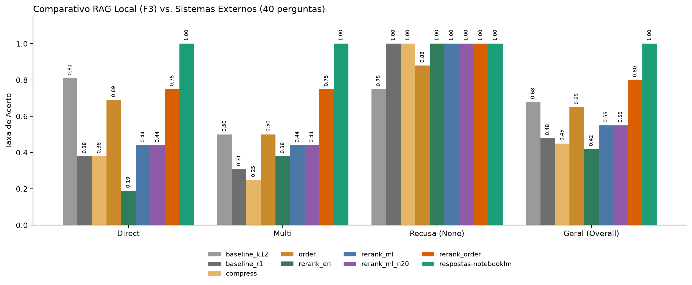

# Análise Comparativa: RAG Local (Família 3) vs. NotebookLM vs. ChatGPT

Este relatório consolida a avaliação comparativa sobre o corpus normativo **Petrobras × Vale** (`Arquivo1.md` a `Arquivo6.md`), utilizando o conjunto expandido de **40 perguntas** (`questions.json`, composto por 16 questões `direct`, 16 `multi` e 8 `none`) e uma arquitetura de avaliação em **dupla camada (Léxica e Semântica)**.



---

## 1. Enquadramento Metodológico dos Sistemas Avaliados

O experimento confronta três abordagens arquiteturais distintas operando exatamente sobre os mesmos seis documentos normativos e submetidas às mesmas regras de ancoragem (*grounding*), citação de fontes e recusa.

O primeiro sistema é o **RAG Local (`rag-f3-local.ipynb`)**, construído sobre embeddings densos (`nomic-embed-text`), técnicas de pós-recuperação da Família 3 (*Reranking*, *Compressão* e *Ordering*) e o gerador compacto local `qwen2.5:3b`. Sua principal vantagem reside na execução integralmente local, com custo zero de API e controle total sobre hiperparâmetros de *chunking*, tamanho de top-$k$, reordenação e posicionamento de trechos no prompt. Em contrapartida, por contar com um gerador de apenas 3 bilhões de parâmetros, o sistema é mais sensível ao fenômeno *lost in the middle* e tende ao conservadorismo excessivo (recusas falsas) quando a janela de contexto se aproxima de 5.800 tokens.

O segundo sistema avaliado é o **NotebookLM (`respostas-notebooklm.json`)**, que representa uma arquitetura de RAG gerenciado acoplada a um modelo de fronteira da família Gemini, projetada especificamente para *grounding* estrito sobre fontes carregadas pelo usuário. Nos testes, o NotebookLM destacou-se pela capacidade de leitura integral e síntese multi-documento (`gold_all = 1.00`), preservando visibilidade sobre detalhes de rodapé, glossários e tabelas, embora opere como uma caixa-preta em nuvem sem possibilidade de ajuste fino sobre os parâmetros internos de recuperação.

O terceiro sistema é o **ChatGPT Web (`respostas-chatgpt.json`)**, utilizado por meio do upload direto dos seis arquivos na interface conversacional. Embora apresente excelente fluidez textual, alta precisão em perguntas diretas e respeito absoluto à regra de recusa (`none = 1.00`), os testes revelaram uma limitação arquitetural decisiva: o ChatGPT não mantém os seis arquivos inteiros ativos no prompt a cada pergunta, mas aciona uma ferramenta interna de busca fragmentada (*File Search*). Como consequência, ele consulta apenas trechos parciais dos anexos e acaba perdendo informações localizadas em rodapés e finais de documentos extensos em perguntas multi-documento (`m09`, `m11`, `m15` e `m16`).

---

## 2. Como Funciona a Avaliação: O Grader, o Critério Léxico e o Critério Semântico

Para garantir isonomia na comparação entre o pipeline local e as ferramentas externas em nuvem, o protocolo de avaliação implementado no notebook (`rag-f3-local.ipynb`) e no script consolidador (`compare_external.py`) desacopla as métricas de recuperação das métricas de qualidade da resposta final, estruturando a correção das respostas em duas camadas complementares: a avaliação léxica e a avaliação semântica.

### 2.1. O que é o *Grader* (Avaliador Automático) e a Estrutura do Gabarito

O *Grader* é o motor de verificação automática que recebe a resposta textual produzida por um modelo e a confronta com o gabarito estruturado no arquivo `questions.json`. Cada uma das 40 perguntas do gabarito é descrita por sua categoria de dificuldade (`tier`), pela lista de documentos onde a resposta se encontra (`gold_docs`), pelos termos ou conceitos obrigatórios que devem constar na resposta (`must_contain`) e por um indicador booleano que define se a pergunta deve ser recusada por ausência de previsão nos documentos (`expect_refusal`).

```json
{
  "id": "m01",
  "tier": "multi",
  "question": "Qual a diferença na periodicidade máxima de revisão do Código de Conduta entre a Petrobras e a Vale?",
  "gold_docs": ["Arquivo1.md", "Arquivo2.md"],
  "must_contain": [
    ["dois anos", "2 anos", "2 (dois) anos"],
    ["3 (três) anos", "3 anos", "três anos"]
  ],
  "expect_refusal": false
}
```

A partir dessa estrutura, o sistema apura primeiramente a eficácia da etapa de recuperação e citação por meio das métricas `gold_hit` e `gold_all`. A métrica `gold_hit` assume valor verdadeiro sempre que pelo menos um dos documentos listados em `gold_docs` foi recuperado pelo índice (no caso do RAG local) ou explicitamente citado entre colchetes `[ArquivoX.md]` (no caso dos sistemas externos). Já a métrica `gold_all` exige que absolutamente todos os documentos previstos em `gold_docs` estejam presentes, sendo o indicador central para aferir se, nas perguntas `multi`, o sistema foi capaz de recuperar simultaneamente as normas das duas empresas. Em seguida, o *Grader* avalia o mérito da resposta propriamente dita (`correct`), aplicando os critérios léxico e semântico descritos a seguir.

### 2.2. O que é a Avaliação Léxica (`grade` / `correct_strict`)

A avaliação léxica consiste na verificação determinística e automatizada da presença de sequências exatas de caracteres (*substrings*) dentro da resposta gerada, após uma rotina de padronização ortográfica. No código, tanto o texto da resposta quanto os termos exigidos em `must_contain` passam inicialmente pela função de normalização `norm(s)`, que converte todos os caracteres para letras minúsculas, aplica a decomposição Unicode (`NFKD`) para suprimir acentos gráficos e cedilhas — transformando, por exemplo, `"ética"` em `"etica"` e `"Administração"` em `"administracao"` — e colapsa espaços em branco consecutivos.

Concluída a normalização, o avaliador léxico verifica se a resposta contém a cláusula padrão de recusa exigida pelo prompt do sistema (`"os documentos corporativos nao cobrem esta informacao"`). Quando a pergunta pertence ao grupo `none` (`expect_refusal: true`), o modelo recebe nota máxima se, e somente se, acionar essa recusa, sendo penalizado como alucinação caso tente fornecer um valor inventado ou inferido de conhecimento externo. Por outro lado, quando a pergunta é respondível (`direct` ou `multi`, onde `expect_refusal: false`), o avaliador léxico exige simultaneamente que o modelo não tenha recusado a resposta e que todos os grupos de conceitos listados em `must_contain` estejam presentes no texto (operador lógico `E`). Para reduzir a rigidez diante de variações numéricas ou siglas, cada item de `must_contain` pode ser declarado como uma sublista de grafias equivalentes (como `["3 (três) anos", "3 anos", "três anos"]`), bastando que uma única alternativa da sublista seja encontrada na resposta (operador lógico `OU`).

### 2.3. O que é a Avaliação Semântica (`judge_correct` / *LLM-as-a-Judge*)

Embora a avaliação léxica seja indispensável por sua reprodutibilidade, rapidez e ausência de subjetividade ao comparar dezenas de rodadas locais, ela enxerga apenas formas superficiais de palavras e não interpreta o sentido das proposições. Quando aplicada a modelos de linguagem mais articulados, como o ChatGPT, a checagem puramente léxica está sujeita a duas distorções clássicas em sentidos opostos: os falsos negativos léxicos e os falsos positivos léxicos.

O **falso negativo léxico** ocorre quando o modelo responde ao mérito da pergunta com total precisão factual, mas utiliza uma formulação linguística, sinônimo, flexão verbal ou formato de data distinto das strings cadastradas em `must_contain`. Em nossos testes, isso ocorreu quando o ChatGPT escreveu `"28 de abril de 2026"` em vez de `"28/04/2026"` na questão `d09`, `"16 de dezembro de 2020"` em vez de `"16/12/2020"` na questão `d16`, e utilizou a forma verbal `"confirmar a existência de tratamento"` em vez do substantivo `"confirmação"` na questão `m08`. Em todos esses três casos, a resposta estava materialmente correta, mas foi reprovada pela busca literal de caracteres.

Inversamente, o **falso positivo léxico** acontece quando o modelo falha em recuperar a informação solicitada, mas repete os termos-chave contidos no próprio enunciado da pergunta para declarar que não encontrou o dado nos documentos. O exemplo mais emblemático no experimento ocorreu na pergunta `m09`, que indagava como o valor `'A vida em primeiro lugar'` da Vale se conectava às diretrizes de Gestão de Riscos. O ChatGPT respondeu que *"os documentos não estabelecem uma conexão expressa entre o valor 'A vida em primeiro lugar' e diretrizes específicas da Política de Gestão de Riscos"*. Como a sequência de caracteres `'a vida em primeiro lugar'` estava presente dentro dessa afirmação negativa, o avaliador léxico atribuiu acerto automático a uma resposta conceitualmente incorreta.

A **avaliação semântica** atua como uma segunda camada de auditoria para corrigir ambas as distorções, julgando a equivalência de significado e a completude factual da resposta frente ao gabarito. Para viabilizar esse processo de forma estruturada, o script `compare_external.py` identifica automaticamente todas as respostas reprovadas no filtro léxico e as exporta, juntamente com a lista de termos ausentes (`missing_keywords`), para o arquivo `results/external/para_auditar_judge.json`. Na camada semântica, paráfrases fiéis e datas por extenso são validadas como acertos legítimos, ao passo que respostas que alegam ausência de informação nos trechos consultados (como ocorreu com o ChatGPT em `m09` e `m16`) são devidamente reclassificadas como falhas de recuperação.

---

## 3. Placar Consolidado (40 Perguntas)

A tabela a seguir sintetiza o desempenho de todas as variantes locais do notebook em comparação com o ChatGPT Web e o NotebookLM, apresentando lado a lado a taxa de acerto pelo critério léxico estrito e pelo critério semântico auditado. Os arquivos brutos correspondentes encontram-se em `results/summary_comparativo.csv`, `results/results_ext_respostas-notebooklm.csv` e `results/results_ext_respostas-chatgpt.csv`.

| Variante / Sistema | Direct (16) | Multi (16) | Recusa / None (8) | **Acerto Geral Léxico Estrito (40)** | **Acerto Geral Semântico Real (40)** | `gold_hit` | `gold_all` | Contexto Médio (tokens) | Latência Média (s) |
| :--- | :---: | :---: | :---: | :---: | :---: | :---: | :---: | :---: | :---: |
| **`baseline_r1` ($k=4$)** | 0.38 | 0.31 | 1.00 | **0.48** | **0.48** | 0.91 | 0.78 | 1.959 | 5.40s |
| **`rerank_en` ($n=12 \to k=4$)** | 0.19 | 0.38 | 1.00 | **0.42** | **0.42** | 0.97 | 0.88 | 1.999 | 5.82s |
| **`compress` ($k=4$ comprimido)** | 0.38 | 0.25 | 1.00 | **0.45** | **0.45** | 1.00 | 0.88 | 539 | 6.16s |
| **`rerank_ml` ($n=12 \to k=4$)** | 0.44 | 0.44 | 1.00 | **0.55** | **0.55** | 1.00 | 0.88 | 2.011 | 5.89s |
| **`rerank_ml_n20` ($n=20 \to k=4$)** | 0.44 | 0.44 | 1.00 | **0.55** | **0.55** | 1.00 | 0.91 | 2.029 | 6.44s |
| **`order` ($k=12$ nas pontas)** | 0.69 | 0.50 | 0.88 | **0.65** | **0.65** | 1.00 | 0.97 | 5.846 | 7.91s |
| **`baseline_k12` ($k=12$)** | 0.81 | 0.50 | 0.75 | **0.68** | **0.68** | 1.00 | 0.97 | 5.846 | 7.65s |
| **`rerank_order` ($n=12$, rerank + pontas)** | 0.75 | **0.75** | **1.00** | **0.80** | **0.80** *(32/40)* | 1.00 | 0.97 | 5.846 | 8.37s |
| **ChatGPT (Web)** | **0.88** *(1.00 sem.)* | **0.81** *(0.75 sem.)* | **1.00** | **0.88** *(35/40)* | **0.90** *(36/40)* | **1.00** | **1.00** | — | — |
| **NotebookLM (Web)** | **1.00** | **1.00** | **1.00** | **1.00** *(40/40)* | **1.00** *(40/40)* | **1.00** | **1.00** | — | — |

---

## 4. Evolução das Técnicas Locais da Família 3 e Análise do ChatGPT

A progressão dos resultados locais demonstra com clareza o papel de cada intervenção da Família 3 sobre o contexto entregue ao gerador. No `baseline_r1` ($k=4$), o acerto geral limitou-se a 48% porque uma janela de apenas quatro blocos é insuficiente para capturar fatos distribuídos em rodapés, glossários ou múltiplos arquivos (`gold_all = 0.78`). Ao substituir a seleção por um Cross-Encoder em inglês (`rerank_en`), o resultado caiu para 42%, comprovando que um reranker monolíngue em inglês degrada a ordenação de textos normativos em português. Já a adoção do Cross-Encoder multilíngue (`rerank_ml`) elevou o `gold_hit` para 100%, o `gold_all` para 88% e o acerto geral para 55%, mantendo o mesmo orçamento enxuto de ~2.000 tokens.

Quando expandimos o contexto bruto para doze blocos em `baseline_k12`, a recuperação tornou-se quase perfeita (`gold_all = 97%`) e o acerto em perguntas diretas saltou para 81%. Todavia, surgiram dois sintomas clássicos de degradação por contexto longo: a taxa de recusa correta nas perguntas `none` caiu de 100% para 75% (com alucinações em `n02` e `n04`) e o acerto nas perguntas `multi` estacionou em 50%, uma vez que o segundo documento necessário frequentemente caía nas posições intermediárias do prompt (posições 5 a 9), sendo ignorado pelo `qwen2.5:3b` devido ao efeito *lost in the middle*. A combinação de reclassificação multilíngue com o posicionamento estratégico nas extremidades do prompt (`rerank_order`) resolveu ambos os problemas: ao colocar os documentos mais relevantes no início e no final absoluto do contexto, o acerto em perguntas `multi` subiu de 50% para 75%, a precisão nas recusas retornou a 100% e o acerto geral atingiu 80%.

No caso do **ChatGPT Web**, o confronto entre a avaliação léxica e a semântica revelou o funcionamento prático de sua arquitetura de leitura de anexos. Após corrigir os três falsos negativos léxicos decorrentes de datas por extenso e variação verbal (`d09`, `d16` e `m08`), o ChatGPT alcançou 100% de aproveitamento nas perguntas diretas (`16/16`). Contudo, nas perguntas multi-documento (`multi`), o modelo apresentou quatro falhas reais causadas pelo seu mecanismo interno de busca fragmentada (*File Search*), que o próprio ChatGPT evidenciou ao empregar a expressão *"no trecho consultado"* nas respostas `m07` e `m16`.

A primeira falha real do ChatGPT ocorreu na questão `m11`, que pedia a comparação das datas de aprovação dos Códigos de Conduta da Vale (`28/04/2026`) e da Petrobras (`27/09/2024`). Como a data da Petrobras encontra-se na última linha (linha 481) do `Arquivo2.md` — o maior documento do corpus, com cerca de 50 KB —, o buscador interno do ChatGPT não recuperou o bloco final do arquivo e afirmou incorretamente que os documentos não informavam a data de aprovação da Petrobras. A segunda falha deu-se em `m15`, onde o ChatGPT listou apenas cinco códigos de políticas (`POL`) situados na metade inicial do documento e omitiu `POL-0035-G`, `POL-0037-G` e `POL-0041-G`, questão na qual o `rerank_order` local superou o ChatGPT ao recuperar os blocos corretos. A terceira e a quarta falhas ocorreram em `m09` e `m16`: em `m09`, o ChatGPT negou existir conexão expressa entre o valor `'A vida em primeiro lugar'` e a Política de Gestão de Riscos da Vale (deixando de ler o segundo parágrafo do `Arquivo5.md`), enquanto em `m16` declarou que a definição completa de dados pessoais sensíveis na cartilha da Petrobras não havia sido identificada no trecho consultado do `Arquivo4.md`. Em ambas as questões (`m09` e `m16`), tanto o `rerank_order` local quanto o NotebookLM localizaram e sintetizaram os trechos sem dificuldade.

---

## 5. Diagnóstico dos 8 Erros do Melhor RAG Local (`rerank_order` = 80%) vs. NotebookLM (100%)

Enquanto o NotebookLM respondeu com exatidão às 40 perguntas, a variante local mais forte (`rerank_order`) cometeu oito erros. A análise individualizada dessas oito ocorrências demonstra que o gargalo residual do sistema local não está na recuperação vetorial ou no reranking, mas sim na capacidade de leitura e síntese do gerador compacto de 3B parâmetros diante de contextos extensos:

| ID | Tier | `gold_all` no `rerank_order` | Posições dos Chunks Gold | Diagnóstico da Falha no RAG Local (`qwen2.5:3b`) | Comportamento do NotebookLM |
| :--- | :---: | :---: | :---: | :--- | :--- |
| **`d04`** | `direct` | `True` | `1` | **Recusa indevida (Falso Negativo):** Mesmo com `Arquivo6.md` na posição 1 do prompt, o `qwen2.5:3b` respondeu que os documentos não cobriam a informação. | Identificou o `Conselho de Administração (CA)` no item 5.1.1 de `[Arquivo6.md]`. |
| **`d05`** | `direct` | `True` | `2` | **Recusa indevida (Falso Negativo):** O bloco de `Arquivo4.md` estava na posição 2, mas o gerador local acionou a recusa por excesso de conservadorismo. | Identificou o `Gerente Geral de Privacidade` em `[Arquivo4.md]`. |
| **`d06`** | `direct` | `True` | `1\|2\|3\|8\|11` | **Recusa indevida (Falso Negativo):** `Arquivo5.md` ocupava as três primeiras posições do prompt, mas o gerador 3B recusou a resposta. | Listou `ISO 31000`, `ISO 55000`, `COSO-ERM` e `RBPS` citando `[Arquivo5.md]`. |
| **`d16`** | `direct` | `True` | `1\|7` | **Omissão da segunda metade da pergunta:** Citou corretamente o `artigo 16` do Estatuto Social, mas esqueceu de informar a data de aprovação (`16/12/2020`). | Respondeu ambos os fatos (`artigo 16` e `16/12/2020`) citando `[Arquivo6.md]`. |
| **`m02`** | `multi` | `False` | `1` | **Falha de recuperação parcial:** Único caso em que faltou um documento gold entre os 12 candidatos (`Arquivo3.md` ficou de fora; entrou apenas `Arquivo4.md`). | Cruzou a definição conceitual do DPO em `[Arquivo3.md]` com o cargo em `[Arquivo4.md]`. |
| **`m10`** | `multi` | `True` | `1\|2\|3\|5..12` | **Recusa indevida em pergunta de síntese:** O `qwen2.5:3b` iniciou a resposta com a frase padrão de recusa antes de tentar articular os dois documentos. | Articulou o princípio 3.3 de `[Arquivo6.md]` com a análise de riscos em `[Arquivo2.md]`. |
| **`m11`** | `multi` | `True` | `2\|3\|4..12` | **Perda de detalhe de rodapé:** A data de aprovação está na última linha de `Arquivo1.md` e `Arquivo2.md`; o gerador 3B não localizou ambas no meio dos 12 blocos. | Extraiu com precisão `28/04/2026` (`[Arquivo1.md]`) e `27/09/2024` (`[Arquivo2.md]`). |
| **`m13`** | `multi` | `True` | `1\|2\|3\|4\|6\|9\|11\|12` | **Confusão entre entidades na síntese:** Atribuiu o `Comitê Executivo` tanto à Vale quanto à Petrobras, omitindo a `Diretoria Executiva` da Petrobras. | Distinguiu claramente `Comitê Executivo` (`[Arquivo5.md]`) e `Diretoria Executiva (DE)` (`[Arquivo6.md]`). |

---

## 6. Comparativo Direto dos 3 Sistemas nas Perguntas Críticas

| Caso Avaliado | RAG Local (`rerank_order` - Qwen 3B) | ChatGPT Web (File Search) | NotebookLM (Gemini Grounded) |
| :--- | :--- | :--- | :--- |
| **`d09` e `d16` (Datas de aprovação)** | Acertou `d09` (`28/04/2026`); omitiu a data em `d16` | Acertou ambas semanticamente (escreveu as datas por extenso) | Acertou ambas no formato numérico exato (`28/04/2026` e `16/12/2020`) |
| **`m09` (Conexão 'A vida em primeiro lugar' e Riscos)** | **Acertou** (localizou o trecho no `Arquivo5.md`) | **Errou** (negou haver conexão expressa — *Falso Positivo Léxico*) | **Acertou** |
| **`m11` (Datas no rodapé de `Arquivo1` e `Arquivo2`)** | **Errou** (recusou por perder o rodapé em meio a 12 chunks) | **Errou** (afirmou que `Arquivo2.md` não informa a data) | **Acertou** (`28/04/2026` e `27/09/2024`) |
| **`m15` (Cruzamento exaustivo de códigos `POL`)** | **Acertou** (incluiu `POL-0041-G` e `POL-0037-G`) | **Incompleto** (omitiu `POL-0041-G`, `POL-0035-G` e `POL-0037-G`) | **Acertou** (listou todas as 8 políticas em comum) |
| **`m16` (Dados Sensíveis em `Arquivo3` e `Arquivo4`)** | **Acertou** (trouxe a definição completa da Vale e da Petrobras) | **Incompleto** (não achou a definição no trecho consultado de `Arquivo4.md`) | **Acertou** |
| **`n01` a `n08` (8 Perguntas-Armadilha sem resposta)** | **100% de recusa correta (8/8)** | **100% de recusa correta (8/8)** | **100% de recusa correta (8/8)** |

---

## 7. Conclusão Geral do Experimento

Os resultados consolidados permitem extrair três conclusões centrais. Em primeiro lugar, o **NotebookLM** mostrou-se o único sistema 100% consistente nas 40 questões tanto sob o crivo léxico quanto sob o semântico, comprovando que sua arquitetura dedicada de indexação documental preserva visibilidade completa até mesmo sobre informações periféricas de rodapé (`m11`) e cruzamentos exaustivos de listas normativas (`m15`).

Em segundo lugar, ficou demonstrado que o simples envio de arquivos para o **ChatGPT Web** não equivale à leitura integral do corpus em janela longa: o acionamento de busca fragmentada (*File Search*) levou o modelo a falhar em quatro perguntas multi-documento (`m09`, `m11`, `m15` e `m16`). Sob avaliação semântica rigorosa nas perguntas `multi`, o pipeline local com **`rerank_order` (`qwen2.5:3b`) empatou com o ChatGPT em 75% de acerto (12/16) e superou diretamente a ferramenta da OpenAI em três questões (`m09`, `m15` e `m16`)**, evidenciando que um pós-processamento bem calibrado da Família 3 compensa grande parte da diferença de escala do modelo gerador.

Por fim, o experimento valida a importância metodológica de combinar **avaliação léxica e avaliação semântica**: enquanto o Grader Léxico assegura velocidade e determinismo para comparar múltiplas intervenções de engenharia de contexto, a auditoria semântica impede que variações legítimas de redação sejam punidas (`d09`, `d16` e `m08`) e revela falhas ocultas em que o modelo repete palavras da pergunta sem entregar o conteúdo exigido (`m09` e `m16`).
